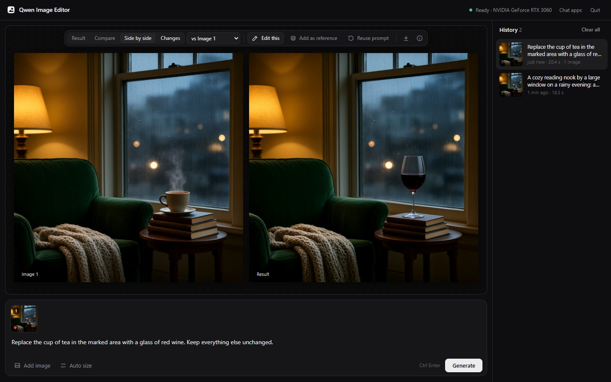
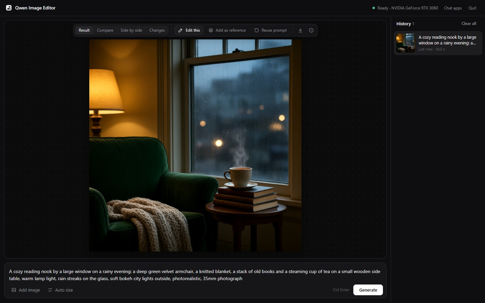
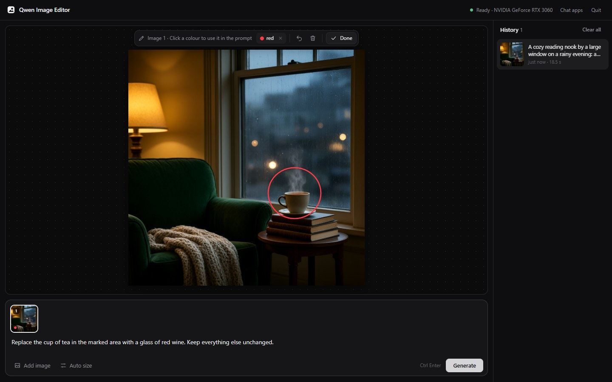

# Qwen Image Editor

**Point-and-say image editing with Qwen-Image-2.1-Turbo, running on your own computer.** Describe an image to create
it, or draw around part of a picture and say what should change. Use it in the browser, or from Claude Desktop, Goose
and ChatGPT, where the AI writes the prompts and the images are made locally.

[](https://github.com/loopforge0/qwen-image-editor/releases/latest)


[](LICENSE)
[](#the-model-research-use-only)



> [!IMPORTANT]
> **The model is not included, and it is for research and non-commercial use only.**
> This project is the editor: it contains no model weights. Qwen-Image-2.1 is made by Qwen (Alibaba Cloud) and
> released under the [Qwen Research License Agreement](https://huggingface.co/Qwen/Qwen-Image-2.1-Turbo/blob/main/LICENSE), which
> allows research and other non-commercial use only. The editor's setup shows that license and downloads the model
> from Hugging Face only after you accept it. Using the model, through this editor or otherwise, is governed by that
> license. This project is not affiliated with or endorsed by Qwen or Alibaba Cloud.

## Download

Get the installer from the [latest release](https://github.com/loopforge0/qwen-image-editor/releases/latest):

| | Installer | Needs |
|---|---|---|
| **Windows** | `QwenImageEditor-Setup-<version>.exe` | NVIDIA graphics card with 12 GB+ memory, driver 580 or newer, 32 GB RAM recommended, about 25 GB free disk |
| **macOS** | `QwenImageEditor-<version>.dmg` | Apple Silicon Mac, macOS 14 or newer |

On first start the editor walks you through a one-time setup: it checks your computer, shows the model's license,
and downloads the model (about 17 GB). Already have the models in ComfyUI? It can use those instead. The installers
aren't code-signed yet, so Windows SmartScreen and macOS ask before the first start.

## What it does

<table>
<tr>
<td width="50%"></td>
<td width="50%"></td>
</tr>
<tr>
<td><b>Create</b> an image from a description, in about 20 seconds on an RTX 3060.</td>
<td><b>Edit</b> by drawing around what should change and saying what to do: "replace the cup in the red circle
with a glass of red wine".</td>
</tr>
</table>

- **Compare** each result with the original: a slider, side by side, or a map of what changed.
- **Combine** several images: "put the person from image 2 on the sofa in image 1".
- **Chat apps:** connect Claude Desktop, Goose or ChatGPT, and ask for images in the chat. They appear in a widget
  where you can edit them further.
- **Local:** the images are made on your computer. In the browser editor nothing leaves it; with a chat app, that
  app's AI sees the prompts and the images you share in the chat.

## The model: research use only

Qwen-Image-2.1-Turbo is not part of this project and isn't in the installers. It's released by Qwen under the
[Qwen Research License Agreement](https://huggingface.co/Qwen/Qwen-Image-2.1-Turbo/blob/main/LICENSE): research and other
non-commercial use only. Read the license before downloading the model; the editor's setup shows it and asks you to
accept it first. This project's license (Apache-2.0, see [LICENSE](LICENSE)) covers the editor's code only, not
the model.

## Run from source (Windows/Linux, NVIDIA 12 GB+)

You need git, an NVIDIA driver 580 or newer, and [uv](https://docs.astral.sh/uv/):

```
# Linux
curl -LsSf https://astral.sh/uv/install.sh | sh
source $HOME/.local/bin/env        # or open a new terminal

# Windows (PowerShell); then open a new terminal
powershell -ExecutionPolicy ByPass -c "irm https://astral.sh/uv/install.ps1 | iex"
```

Then, in the project folder:

```
uv sync
uv run qie setup        # checks your PC, shows the license, downloads ~17.3 GB of models
uv run qie app          # the editor, at http://127.0.0.1:7861
```

Already have the models, in ComfyUI or any folder? `uv run qie setup --comfyui C:\ComfyUI` uses them in place.
`uv run qie doctor` shows what's set up. From the command line:

```
uv run qie generate "a red fox in the snow"
uv run qie generate "make it night time" -i photo.jpg
uv run qie generate "put the person from <image1> on the sofa in <image2>" -i person.png -i room.jpg
```

Settings and downloaded models live in `%LOCALAPPDATA%\qwen-image-editor` (Windows) or
`~/.local/share/qwen-image-editor` (Linux). `QIE_TRANSFORMER`, `QIE_TEXT_ENCODER` and `QIE_CONFIG_DIR` override the
model paths.

## Installers

- Windows: `installer\windows\build.ps1` builds `dist\QwenImageEditor-Setup-<version>.exe` (needs
  [Inno Setup 6](https://jrsoftware.org/isinfo.php)). Per-user install, Start menu shortcut, uninstaller.
- macOS (Apple Silicon): `bash installer/macos/build.sh`, run on a Mac, builds `dist/QwenImageEditor-<version>.dmg`.

Both include the editor and [uv](https://docs.astral.sh/uv/), nothing of Qwen's. On first start the editor opens a
setup page that checks the computer, shows the model's license, and downloads the model (on a Mac it then converts
it to MLX). Neither is code-signed yet, so Windows SmartScreen and macOS Gatekeeper ask before the first start.
The Windows installer and the setup page also offer to connect Claude Desktop, Goose and ChatGPT, when they're
installed.

Uninstalling: on Windows use Settings > Apps (it asks whether to keep the models, and takes the editor out of the
chat apps). On a Mac, disconnect the chat apps first (Chat apps, top right in the editor), quit the editor from the
menu-bar icon, drag the app to the Bin, and delete `~/Library/Application Support/qwen-image-editor` (models,
settings, history and the editor's Python).

## Chat apps (MCP)

In Claude Desktop, Goose or the ChatGPT desktop app, the AI writes the prompts and the images are made on your
computer. Connect them with the **Chat apps** button in the editor (or `uv run qie connect`; `qie disconnect` undoes
it), then restart them. ChatGPT has its own image generator, so ask it to use Qwen ("make it with Qwen: ..."); there
the widget opens in the side panel and stays current.
`qie connect --list` shows what's connected. Other MCP apps: run `uv run --project <this folder> qie mcp` (stdio).

Ask for an image, and it appears in a widget in the chat with the compare views. To edit, press **Edit this** (or
open the editor and drop an image in), draw around what should change, then say in the chat what to do; the AI sees
your marks. Picking an earlier image from the widget's history works the same way.

## Writing prompts

Qwen hasn't published a prompt guide for Qwen-Image-2.1, but the instructions of its prompt rewriter
([edits](https://huggingface.co/Qwen/Qwen-Image-2.1-PE-I2I/raw/main/system_prompt.txt),
[new images](https://huggingface.co/Qwen/Qwen-Image-2.1-PE-T2I/raw/main/system_prompt.txt)) show what the model
expects. In short: describe a new image as a detailed paragraph (medium and subject, what is where, lighting,
composition), with any text to show in double quotes. For an edit, lead with the change, make it clear, and add
"keep everything else unchanged" rather than describing what should stay. Several images are `<image1>`, `<image2>`,
... in the order added. Chat apps are given these rules, so their AI writes prompts this way.

## The editor

Drop or paste an image, click it to draw marks on it (each mark gets its own colour), describe the change
("replace the lamp in the red circle"), and generate. Several images can be combined ("put the person from <image2>
on the sofa in <image1>"; "image 2" works too). Results can be compared with a slider, side by side, or as a map of what changed, and any
result can be edited further. Everything stays on your machine; the history is kept in the `history` folder of the
editor's data folder (see above).

The page is plain HTML, CSS and JavaScript in `app/static/` with no build step; the server is Python's standard
library on top of the engine.
